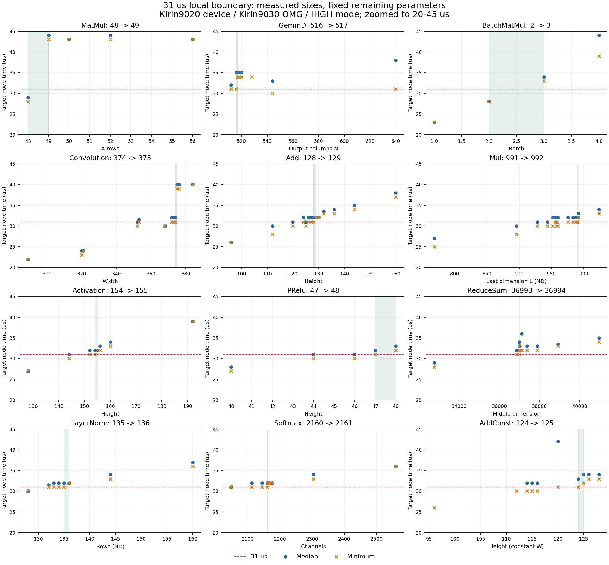

# 31 µs 局部临界点与 ND 布局修正

12 个配置变体（11 类算子，Add 分两种）完成临界点实测。每个端点至少 3 组，每组 25 次、剔除前 5 次预热；上端点的全部保留样本严格大于 31 µs，下端点至少出现一次 ≤31 µs。

Mul 的两个核心输入为 ND，LayerNorm 的输入/scale/bias 为 ND，ReduceSum 的核心输入为 ND。均通过真机输出与 ONNX Runtime 数值比对（atol=0.003、rtol=0.03），TransData=0，目标设备类型为 `npu_aicore`。

**ConvTranspose 尚未满足一维 ND bias 要求，CastT 尚未取得独立 NPU 耗时，因此不计入达标结论。**

## 测量范围

USB 设备实际上报 **Kirin9020 / MOR**，固件 `MOR-W52 6.1.0.125(SP10ENTC302E101R1P1log)`。编译使用 **Kirin9030 OMG / DDK-tools-next-6.1.1.0**。工具版本 `109.633.120.010`，请求 HIGH（dev_perf=3），启用 PMU；没有宣称时钟锁定，也不是 Kirin9030 真机结果。

每次只改变表中一个维度，其余参数固定。采用分段缩小和复测；算子实现可能随 shape 切换，耗时不保证单调。这些是本次采样的局部边界，不是全参数空间最小值，也不保证其他设备/温度/DDK 下始终超过阈值。31/32 µs 附近有量化和抖动，所有已出现的低样本和偶发高延迟均保留，没有挑选有利的组。

## 临界值

下端点 → 上端点；时间栏为跨所有保留样本的“最小值 / 中位数”，单位 µs。输入及权重是 ONNX 逻辑 shape，参数文件给出完整配置。

| 变体（实际类型见 JSON） | 扫描变量 | 临界值 | 下端时间 | 上端时间 | 样本数（下/上） |
|---|---|---:|---:|---:|---:|
| MatMul | A rows M; K=6144, B columns=2 | 48 → 49 | 28 / 29 | 43 / 44 | 60 / 60 |
| GemmD | weight/output columns N; A=[128,288],W=[288,N],bias=[N] | 516 → 517 | 31 / 35 | 34 / 35 | 60 / 60 |
| BatchMatMul | batch B; M=2,K=N=256 | 2 → 3 | 28 / 28 | 33 / 34 | 60 / 60 |
| Convolution | input width W; N=1,C=96,H=5 | 374 → 375 | 31 / 32 | 39 / 40 | 60 / 60 |
| Add | both input heights H; N=1,C=16,W=128 | 128 → 129 | 31 / 32 | 32 / 32 | 60 / 60 |
| Mul | both input last dimensions L; shapes=[1,256,L], core ND | 991 → 992 | 31 / 32 | 32 / 33 | 60 / 60 |
| Activation | input height H; N=1,C=16,W=128; Sigmoid | 154 → 155 | 31 / 32 | 32 / 32 | 60 / 60 |
| PRelu | input height H; N=1,C=64,W=128 | 47 → 48 | 31 / 32 | 32 / 33 | 60 / 60 |
| ReduceSum | input middle dimension L; shape=[4,L,1],axes=[0] | 36993 → 36994 | 31 / 32 | 32 / 32 | 60 / 60 |
| LayerNorm | rows N; shape=[N,64],axis=1, core ND | 135 → 136 | 31 / 32 | 32 / 32 | 60 / 60 |
| Softmax | input channels C; shape=[1,C,64,1],axis=2 | 2160 → 2161 | 31 / 32 | 32 / 32 | 60 / 60 |
| AddConst | input/constant heights H; X dynamic,W constant; shapes=[1,16,H,128] | 124 → 125 | 31 / 33 | 32 / 34 | 60 / 60 |

## 上端点 shape 与权重

所有新推荐 ONNX/OMC 数据接口为 FP16；LayerNorm 在算子内部使用 FP32 累积。常量均为固定种子的合成测试值。

| 变体 | 运行时输入 | 常量/权重 | 输出 |
|---|---|---|---|
| MatMul | `[[6144, 2]]` | `[[49, 6144]]` | `[[49, 2]]` |
| GemmD | `[[128, 288]]` | `[[288, 517], [517]]` | `[[128, 517]]` |
| BatchMatMul | `[[3, 2, 256]]` | `[[3, 256, 256]]` | `[[3, 2, 256]]` |
| Convolution | `[[1, 96, 5, 375]]` | `[[96, 96, 5, 1], [96]]` | `[[1, 96, 1, 375]]` |
| Add | `[[1, 16, 129, 128], [1, 16, 129, 128]]` | `[]` | `[[1, 16, 129, 128]]` |
| Mul | `[[1, 256, 992], [1, 256, 992]]` | `[]` | `[[1, 256, 992]]` |
| Activation | `[[1, 16, 155, 128]]` | `[]` | `[[1, 16, 155, 128]]` |
| PRelu | `[[1, 64, 48, 128]]` | `[[64, 1, 1]]` | `[[1, 64, 48, 128]]` |
| ReduceSum | `[[4, 36994, 1]]` | `[]` | `[[1, 36994, 1]]` |
| LayerNorm | `[[136, 64]]` | `[[1, 64], [1, 64]]` | `[[136, 64]]` |
| Softmax | `[[1, 2161, 64, 1]]` | `[]` | `[[1, 2161, 64, 1]]` |
| AddConst | `[[1, 16, 125, 128]]` | `[[1, 16, 125, 128]]` | `[[1, 16, 125, 128]]` |

## ND 编译与端口辨别

Mul/LayerNorm 的 ONNX 仍是标准算子文件。新 `handfree` 模式从校验过的 ONNX 提取 shape、dtype 和精确 initializer 字节，构建未编译 GE AIR，然后由 Kirin9030 OMG（framework=1）编译。AIR、命令、SHA-256 和真实 OMC 解析结果均保留在日志中；没有修改编译后的 OMC。

原手持模型相应节点使用 `generated_lib`；本机 ND Mul/LayerNorm 使用 `elementary_lib`。布局和数值经过验证，并不等于硬件实现与原模型完全相同。

当前 OMG 的公开 Data/NetOutput 仍标记 NCHW；这与核心输入为 ND 是两个不同位置的描述。该路径使用连续逻辑字节，无额外 TransData。ReduceSum 原先核心输入就已经是 ND。不能把公开入口标签当成核心布局，也不能仅凭 ONNX 的维数判断编译后的布局。

双动态 Add 实际核心为 Eltwise；第二输入为 initializer 的 Add 实际核心为 Add。常量版本是同 shape 稠密非零常量，不是标量广播；改变广播方式需要重新测量。GemmD 是配置家族名，本 DDK 实际仍是 GemmV3。MatMul 时间只计 MatMulV2，不包含两个 Permute。

## ConvTranspose 未解决项

原 handfree 匹配节点 `aec_model_gate_deconv4_2_deconv2_ConvTranspose`：X=[1,16,2,128]，权重=[16,1,1,3]/FRACTAL_Z，bias=[1]/FLOAT32/ND，核心是三个端口。当前 DDK 使用四端口实现（output_shape、W、X、bias），权重为 FRACTAL_DECONV，bias 被变成 [1,1,1,1]/FLOAT16/NC1HWC0。

已对照 FP16/FP32 源 ONNX、FP16/FP32 权重选项和未编译 AIR 的 ND bias 描述；当前编译器仍重排 bias。`--input_format ND` 被 OMG 明确拒绝。默认 handfree 模式现在会拒绝发布这种不符要求的产物，临时 OMC 和错误记录保留。旧 50..52 的扫描区间仅是布局不符的对照，不能作为正确 ND bias 的临界点。需使用能保留该实现的 DDK 再验证。

## 复现与文件

```bash
python generate_ops.py --config configs/boundary_upper.json --ddk-root /path/to/DDK-tools --out results_upper
python generate_ops.py --config configs/boundary_lower.json --ddk-root /path/to/DDK-tools --out results_lower
python generate_ops.py --config configs/add_variants.json --ddk-root /path/to/DDK-tools --out results_add
python profile_ops.py --models results_upper --out measured_run1 --target YOUR_DEVICE --hdc /path/to/hdc
```

使用新的 `--out` 重复三组。端点配置只含 `op/params`；上、下端点分别保存在 `configs/boundary_upper.json` 和 `configs/boundary_lower.json`。完整统计、实际核心输入/输出布局、编译哈希和证据路径在 `verification/boundary_31us.json`；CSV 方便筛选，`verification/boundary_curve.json` 保留全部当前配置采样点。

`results_boundary_31us_verified.zip` 解压后：`results/<算子>/<参数>.onnx/.omc/.json`、编译日志及 AIR；`evidence/<变体>/<lower或upper>/run*/` 包括原始 profiling、op.csv、PMU CSV、设备信息、数值输出及全部样本。原始统计保留当时的本机绝对路径，汇总 JSON 提供包内相对索引。



探索过程的所有统计、op/PMU CSV 和原始 profiling 存放在 `exploration/`；端点完整输入输出另存于 `evidence/`。布局对照见 `verification/layout_comparison.json`。公司端需运行整个更新脚本；只把 ONNX 交给旧 framework=5 转换流程不能保留本次 AIR 布局约束。

此轮没有测量功耗。最终阈值依据目标 NPU 核心的 op.csv，不使用模型总延迟或 CPU 时间替代。
